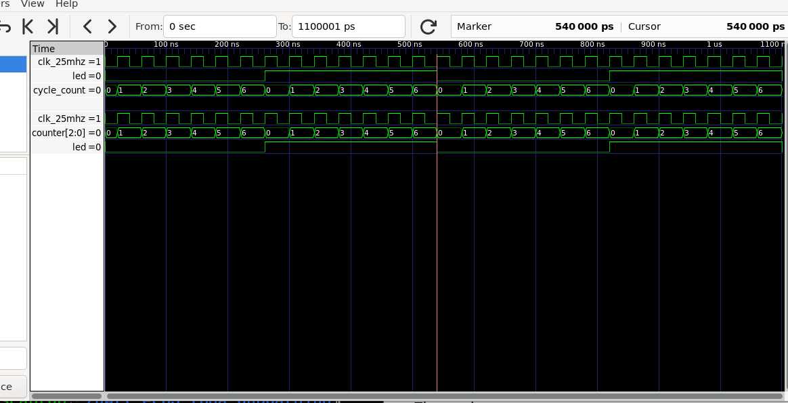
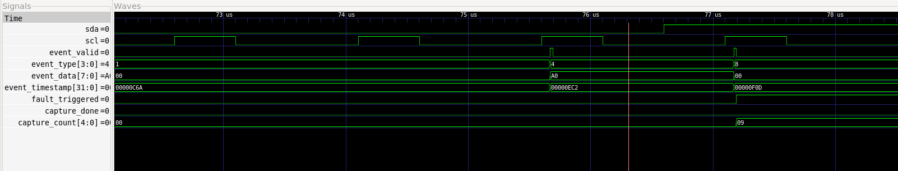

# I²C Protocol Analyzer and Fault Capture

A SystemVerilog-based I²C protocol analyzer that monitors communication between a controller and sensor, decodes transactions, and captures events surrounding communication failures.

I built this project to get more experience with FPGA design, digital protocols, and hardware debugging. I was particularly interested in how debugging tools can identify problems on communication buses without interfering with the devices using them.

The project is entirely simulation-based, using Icarus Verilog for verification, GTKWave for waveform inspection, and Yosys for synthesis.

## What It Does

The analyzer passively monitors the I²C SDA and SCL lines. It identifies:

- START, STOP, and repeated START conditions
- 7-bit device addresses and read/write direction
- Transmitted and received data bytes
- ACK and NACK responses
- Missing-device faults caused by address NACKs
- Normal NACKs sent by the controller after reading data

The main feature is a **fault-triggered circular buffer**.

If a controller attempts to communicate with a sensor that doesn't acknowledge its address, the analyzer records the events leading up to that failure and several events afterward. This makes it possible to see what happened on the bus without manually searching through an entire waveform.

## How It Works

The design is divided into three main components.

```text
       I²C Controller + Sensor
                 |
              SDA / SCL
                 |
                 v
        Input Synchronizer
                 |
                 v
        Transaction Decoder
                 |
                 v
          Event Logger
                 |
                 v
       Circular Fault Buffer
                 |
                 v
          Event Readback
```

### 1. Transaction Decoder

**File:** `rtl/i2c_transaction_decoder.sv`

The decoder uses a finite-state machine to follow I²C communication.

SDA and SCL are first synchronized to a faster system clock. The decoder then looks for START and STOP conditions and samples SDA on rising SCL edges.

An 8-bit shift register collects incoming bits, while a counter keeps track of the current bit position.

The FSM uses six states: `IDLE`, `ADDR_BITS`, `ADDR_ACK`, `DATA_BITS`, `DATA_ACK`, and `WAIT_END`.

One important part of the design is ACK/NACK classification. An address NACK can indicate that a device isn't responding, while a NACK after the final byte of a read is normal I²C behavior. The decoder distinguishes these based on the current transaction state.

### 2. Event Logger

**File:** `rtl/i2c_event_logger.sv`

Instead of only outputting decoded data, the event logger produces a record each time something happens on the bus.

Each event contains:

| Field | Width | Purpose |
|---|---:|---|
| Event type | 4 bits | START, STOP, address, data, ACK, NACK, etc. |
| Event data | 8 bits | Address/RW byte or transferred data |
| Timestamp | 32 bits | System-clock count when the event occurred |

The simulation uses a 50 MHz system clock, giving each timestamp tick a resolution of 20 ns.

The timestamps make it possible to reconstruct the order of events and investigate the communication sequence surrounding a fault.

### 3. Circular Fault Buffer

**File:** `rtl/i2c_fault_capture.sv`

The fault-capture module continuously maintains a short history of recent I²C events.

When an address NACK is detected, it captures up to 16 events:

- 8 events before the fault
- 1 address-NACK trigger event
- 7 events after the fault

Once the post-trigger events have been collected, the buffer freezes. The stored events can then be read back in chronological order.

The implementation uses a circular buffer with a write pointer, event counter, and trigger state.

The buffer is currently implemented using registers and synthesized logic. Using FPGA block RAM would be a useful improvement for a larger capture depth.

## Testing and Verification

Since this project was designed to work without a physical FPGA, I used SystemVerilog testbenches to simulate the I²C controller and sensor.

The testbenches model open-drain SDA and SCL signals, including devices pulling the lines low and releasing them.

I tested the following situations:

| Test | What it checks |
|---|---|
| START/STOP detection | Correct detection of bus conditions |
| Address decoding | 7-bit address and R/W identification |
| ACK/NACK detection | Successful responses and missing devices |
| Transaction decoding | Data bytes and repeated START sequences |
| Event logging | Event order, payloads, and timestamps |
| Fault capture | Pre-trigger and post-trigger events |
| Clock stretching and reset | Extended SCL-low periods and recovery after reset |

I used Python to automate compilation and simulation with Icarus Verilog.

**Result: 6/6 automated test suites passed.**

To run the tests:

```bash
python3 scripts/run_tests.py
```

The script creates a verification report in `reports/simulation_report.txt`.

### Debugging During Development

A couple of issues came up while implementing and verifying the design.

One was in the repeated START testbench. The simulated sensor wasn't releasing SDA correctly after acknowledging a byte, which meant the analyzer couldn't recognize the next START condition. Fixing the open-drain behavior resolved the issue.

Another issue came up when verifying the circular buffer. The testbench incorrectly compared timestamps after jumping backward to reread an earlier buffer entry. I corrected the verification logic so it checked timestamp ordering separately from random-access readback.

Both issues were useful reminders that testbench behavior needs to be verified just as carefully as RTL.

## Simulation Waveforms

I used GTKWave to inspect the decoded transactions and fault-capture behavior.

### Full I²C Simulation



The waveform shows I²C communication alongside decoded events, event timestamps, and the fault-capture status.

### Address-NACK Fault Trigger



This waveform shows the analyzer detecting an address NACK. The `fault_triggered` signal goes high, and the circular buffer begins collecting post-trigger events.

A readable example of the captured events is available in [fault_capture_log.txt](examples/fault_capture_log.txt).

## Synthesis Results

I synthesized the complete design using Yosys to check that the RTL could be converted into digital logic.

Run synthesis with:

```bash
bash scripts/run_synthesis.sh
```

### Generic Yosys Results

| Resource | Count |
|---|---:|
| Total cells | 2,678 |
| Flip-flop cells | 849 |
| Remaining memory bits | 0 |
| Modules in design hierarchy | 4 |

The event buffer accounts for a significant portion of the storage logic because the current implementation uses flip-flops rather than FPGA block RAM.

These numbers are from generic Yosys synthesis. They are not FPGA-specific LUT counts, and I haven't performed placement, routing, or hardware timing analysis.

The full report is available in `reports/yosys_synthesis.log`.

## Design Assumptions and Limitations

This version focuses on standard 7-bit I²C communication under conventional digital timing assumptions.

The design uses a faster system clock to sample SDA and SCL. Both signals pass through synchronizers before being decoded, so bus transitions must remain stable long enough to be sampled reliably.

The current implementation has a few limitations:

- Only 7-bit I²C addressing is supported.
- Multi-controller arbitration isn't detected.
- There is no programmable glitch filter.
- The capture buffer must be reset before another fault can be recorded.
- No physical FPGA has been used for validation yet.
- Analog signal problems, such as slow rise times and electrical noise, aren't modeled.
- NACK classification uses protocol state rather than application-level knowledge.

The testbench includes clock stretching and reset recovery, but the project hasn't been tested against every possible I²C timing corner case.

## Tools Used

- **SystemVerilog** — RTL design and testbenches
- **Icarus Verilog** — Compilation and simulation
- **GTKWave** — Waveform inspection and debugging
- **Python** — Automated regression testing
- **Yosys** — RTL synthesis and resource reporting
- **Git/GitHub** — Version control and documentation

## What I'd Improve Next

The next step would be to deploy the analyzer on an actual FPGA and connect it to a physical I²C bus.

I'd also like to explore using block RAM for event storage, adding configurable fault triggers, and sending captured events to a computer over UART.

Other possible extensions include 10-bit address decoding, timing violation detection, and more advanced handling of noisy or malformed bus signals.

## Project Status

**Simulation:** Passed all six automated test suites.

**Synthesis:** Completed using Yosys.

**Physical FPGA testing:** Not performed yet.

All results presented here come from simulation or generic RTL synthesis.

---

**Ruhan Shah**  
Electrical Engineering | University of Waterloo

[GitHub Profile](https://github.com/ruhan747shah)
